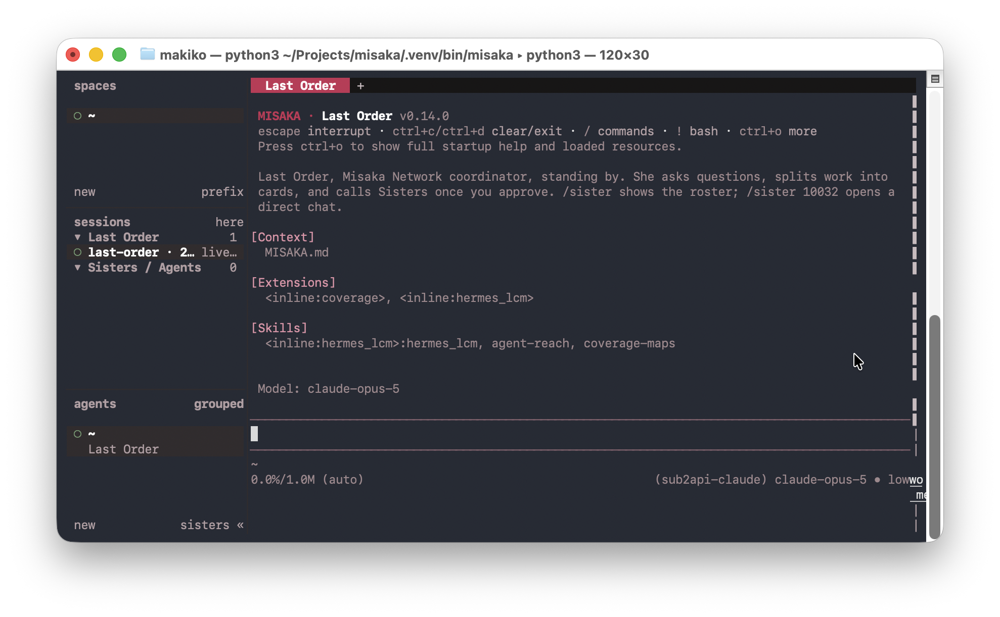

<p align="center"></p>

<h1 align="center">
  <br>
  MISAKA
</h1>

<p align="center"><strong>将 DAG 与症候阅读结合、挖掘多元叙事，专为人文社科研究打造的 AI Agent 架构。</strong></p>

<p align="center"><em>比在场更重要的是缺席！御坂御坂敲了敲你的脑袋。</em></p>

<p align="center">
  <a href="LICENSE"></a>
  
  
</p>

<p align="center"><a href="README.md">English</a> · 简体中文 · <a href="README.ja.md">日本語</a></p>

与协调者 **Last Order**（最后之作）一起拆解问题，完善研究计划，把研究的各个分支领域调查任务派发给善于报告-联络-讨论的 **Sisters**（妹妹们），将各位专家的调研报告汇总归纳，阅读和撰写，与评审员完成答辩，将结论无法涵盖的方向转化为新的研究。用图论算法来管理研究分支图，最终报告以研究论文的形式写进你的项目文件夹，每一处引用都可溯源。

<p align="center">
  
</p>

## 核心设计

<table>
<tr><td><b>像调用Skill一样调用专家Agent</b></td><td>Last Order 调用一位 Sister，如同调用一项技能。技能沿用 Hermes 的分层加载：系统提示只列出每项技能的名称与简介，完整的 SKILL.md 与参考文件在需要时才读取。Sister 按同样的层次暴露：DESCRIBE.md 相当于技能简介，Last Order 平时只看到其简介与开头一段，规划研究时再读取完整介绍与她的技能清单；SOUL.md 与各项技能的正文只在 Sister 自己的会话中载入，不占用 Last Order 的上下文。</td></tr>
<tr><td><b>手段与目的的分工</b></td><td>每位 Sister 配备独立的专长、技能与模型（Claude、GPT、Gemini 或本地模型），负责各自领域的检索与研读；Claude Code 与 Codex 亦可作为成员承接任务。检索与工具操作主要由专家承担，Last Order 的上下文因而专用于研读专家提交的材料。不需思考手段，便可专精目的。</td></tr>
<tr><td><b>症候阅读</b></td><td>红队在核查事实与推理之外，同时研读 Last Order 的推理过程，指认结论未曾言明、却支撑其论证之处。其后的歧路审将此类缺席区分为两类：研究线自身可以弥补的疏漏，在本节点内补足；为其前提所遮蔽的方向，交由 Last Order 决定是否另立研究，不予开立者须载明理由。此即阿尔都塞在症候阅读中区分的两种“不可见”：视而未见者，与问题式所不容看见者。</td></tr>
<tr><td><b>可能性的有向无环图</b></td><td>每一新方向均自 Last Order 的会话分叉，承继此前的全部推理，成为配备独立团队与红队的节点。研究图逐层展开：同一可能只开立一次，多条研究线共同提出的问题只研究一次；殊途同归的研究线在汇合处相互对质，可统合者统合，不可调和者划清分歧。</td></tr>
<tr><td><b>问题的消解</b></td><td>研究可以论证某一问题建立于概念混淆或意识形态预设之上、无法按原样成立，此即正当的研究结论。若由此须改动你所提出的问题，Last Order 将事先征得你的同意。</td></tr>
<tr><td><b>越出 doxa</b></td><td>单次问答的回答，往往止于模型最高频的说法，即一种广为接受而未经检视的 doxa。每份研究计划须附覆盖表，空缺即事先声明的研究缺口；覆盖图取自各学科为自身文献编制的分类体系，其空白处标示出一个领域未曾视为问题的方向，文献扫描则标定问题在学术史中的位置。</td></tr>
<tr><td><b>可溯源</b></td><td>引文可溯至页码与字符位置，上下文可溯至原始对话；具体机制见下文“面向人文社科研究的上下文与材料管理”。</td></tr>
<tr><td><b>研究过程可审计</b></td><td>计划、任务卡、结论的各个版本、批评意见与出处清单，均以 Markdown 文件保存在项目中，项目本身为 git 仓库。MISAKA 仅在你要求并确认文件后提交，论证在批评中的演变完整保留于版本历史。</td></tr>
<tr><td><b>由你主导</b></td><td>每份计划均须经你同意方可执行，确认通过自然对话完成。每个分支在面板中拥有独立标签页，每个 agent 运行于可随时进入的窗格；研究可中止，亦可恢复。</td></tr>
</table>

## 快速开始

```sh
uv tool install "misaka[providers] @ git+https://github.com/Luciole-Studio/Misaka-Agent.git"

mkdir ~/Documents/my-research
cd ~/Documents/my-research
misaka setup     # 登录、选择模型、创建最初的两位 Sister
misaka           # 启动 MISAKA，输入 /research
```

运行环境为 macOS、Linux 或 Windows（x86_64 或 arm64），推荐在 macOS 上运行。需预先安装 [uv](https://docs.astral.sh/uv/)、git、[ripgrep](https://github.com/BurntSushi/ripgrep)、[fd](https://github.com/sharkdp/fd) 与 poppler，并准备一个模型服务商：API 密钥，或 ChatGPT、GitHub Copilot 订阅。亦支持以 Claude 账号登录，相应用量由 Anthropic 按 token 另行计为额外用量。请从本仓库安装：PyPI 上的 `misaka` 为另一无关项目。

每个 GitHub release 也附带上述架构的预编译包。包内包含 uv、git、ripgrep（`rg`）、fd 与 poppler（`pdftotext`）。运行 `misaka` 时，这些工具会进入该进程的 PATH。ocrmypdf、DjVuLibre 与 LibreOffice 仍为可选项，不在包内。

```sh
curl -fsSL https://raw.githubusercontent.com/Luciole-Studio/Misaka-Agent/main/scripts/install.sh | sh
```

Windows（PowerShell）：

```powershell
irm https://raw.githubusercontent.com/Luciole-Studio/Misaka-Agent/main/scripts/install.ps1 | iex
```

`brew install luciole-studio/tap/misaka` 与 `winget install Luciole-Studio.Misaka` 在 tap 和 winget 包发布后使用同一批压缩包。归档布局与发布步骤见 [release/README.md](release/README.md)。

请在 `Documents` 下的工作文件夹中运行 MISAKA（如上例中的 `~/Documents/my-research`），切勿在根目录下运行。

[入门指南](docs/getting-started.zh-CN.md)逐步介绍安装流程，并引导你完成第一个研究问题。

## 研究：`/research`

> *计划写好啦！只要你点头，御坂御坂马上开工！御坂御坂双手捧着计划书说道。*

`/research` 是 MISAKA 的核心功能。一次研究围绕一个问题展开，探索回答它的不同方式：你的问题是第一个节点，Last Order 与你商定计划，Sisters 分头研究，Last Order 撰写结论；红队审查结论，并揭示其所放弃的可能。错误与缺口在本节点内修正；前提不同的真正替代可能则开立为新节点，各自配备 Last Order、Sisters 与红队。研究由此逐层展开为一张研究图，最终形成一篇研究论文。

<p align="center">
  
</p>

### 发起研究

在 Last Order 的窗口输入 `/research`，选择器依次确认以下九项参数，随后输入研究问题。

| 参数 | 含义 |
|---|---|
| 研究深度 | 问题之下可展开的替代可能的层数 |
| 节点并行数 | 同时运行的节点数 |
| 任务卡并行数 | 每个节点同时运行的任务卡数 |
| 追加轮次 | 首轮任务卡之后可追加的研究轮次 |
| 修订次数 | 每轮审查循环（先红队、后歧路审）中结论各可修订的次数 |
| 节点上限 | 整个研究可容纳的节点数，含根节点 |
| 计划审批 | 计划是否须经你同意 |
| 压缩阈值 | 对话压缩的触发比例，仅作用于本次研究 |
| 输出上限 | 模型单次回复的最大长度，仅作用于本次研究 |

也可以在一行中同时给出参数与问题，例如 `/research --depth 2 --max-nodes 12 问题`。未指定的参数取默认值：深度 3，节点与任务卡各并行 4，追加 2 轮，修订 2 次，节点上限 30。在终端中，`misaka research` 接受相同的参数。研究进行中也可以改参数，例如 `/research limits --sister-parallel 2`。

### 节点内部

每个节点，包括你的问题在内，都经历相同的七个环节：

1. **计划。** 计划即研究设计：辨明问题的实际所问与其他可能的含义，指出未经检验的前提，列出所需的证据、方法与来源及其各自的局限，说明每位 Sister 的分工理由。每项任务单独成卡；覆盖表将每个子问题、行动者与维度对应到任务卡，缺口即为空格；红队人选亦在此确定。同一问题存在相互排斥的回答方式时，计划可记录分叉决策，列出至少两个选项及其前提。
2. **任务卡。** Sisters 以及 Claude Code 等协作者在独立会话中并行完成任务卡，逐条申明发现：论断、论断类型（事实、推断、诠释或价值判断）、所依据的文件与页码及引文。任务卡返回后，Last Order 可在追加轮次内再次派出任务。
3. **结论。** Last Order 完整研读交付物后撰写结论，内容包括：共同与相互竞争的发现、关键证据与反证、方法的局限；结论所依赖的前提及其得失，材料未及之处与缺席的声音；以及它如何回应上级节点与竞争选项。结论可以是承担明确代价的立场，也可以是对问题的消解。发现上级节点的事实错误时记录勘误，勘误随原结论显示于其下所有节点与最终报告中。
4. **红队审查。** 红队 Sister 研读结论、计划、证据、研究图与 Last Order 的推理过程，核查事实，提出缺口，检验结论是否回应了上级节点与竞争选项，并指认结论未曾言明、却支撑其论证之处。
5. **答复审查。** Last Order 对每条实质性异议给出唯一答复：修订、反驳、承认代价、指明由其他节点承担、搁置，或提交分叉决策。答复涉及某张卡材料的异议之前，她可以先向提交材料的 Sister 求证，听完回答再定。存在修订时，结论形成新版本，交同一红队复审，直至再无实质异议或修订次数用尽。
6. **歧路审。** 红队这一轮循环结束后，同一位 Sister 在新会话中进行歧路审。她区分前提不同、未被采纳的可能，与任何回答都必须补足的缺口，并逐一揭示结论各项选择背后的预设及其得失。缺口由 Last Order 在本节点内补足或作答；为补缺口而修订的每个版本都再交歧路审复审，直至再无缺口或修订次数用尽。
7. **分叉决策。** 未被采纳的可能逐一记为待开立的选项、已被覆盖，或附理由放弃。答案所依赖的预设亦可成为分叉：为其开立的节点研究该预设是否成立，以及不成立时答案如何改变。

### 研究图的生长

研究逐层推进：同一深度的节点全部完成后，才开始下一层。层与层之间，Last Order 通览整张研究图并加以调和：

- 待开立的选项成为新节点；提出同一问题的选项合并为一个节点，只研究一次。
- 经由不同路径抵达同一处的研究线可以汇合，由新节点承继。汇合处相互对质，可统合者统合，不可调和者划清分歧。
- 节点之间汇合、分歧、呼应、借用与置换的关系均被记录，供最终报告使用。

路径清单记录研究中提出的每一种可能及其去向，同一可能只开立一次。新节点自上级节点的会话分叉，承继其问题的来由。

### 介入与跟进

- **计划审批。** 每份计划，包括层间调和，均可等待你的确认，确认通过自然对话完成。也可以选择自动执行，但改变问题本身的计划始终须经你同意。你还可以跳过某个节点、取消追加轮次，或停止整个研究。
- **随时对话。** 每个节点在面板中拥有独立标签页，你可以随时与该节点的 Last Order 对话。
- **命令与恢复。** `/research status` 查看进度，`/research stop` 停止研究并生成阶段性报告，`/research resume` 恢复停止或失败的研究。任务卡失败后可重试，最多三次；某个节点失败时，同层其余节点照常进行。

### 最终报告

全部节点结束后，Last Order 依次完成逐节点综述、报告初稿、独立红队审查与终稿。报告是一篇面向人文社科读者的研究论文，以问题所用的语言写成，包含标题、摘要与关键词、引言、论证各章与结论。注释与参考文献承载可追溯性；附录依次记录各条研究线，答案承担的代价、勘误与未采纳的路径，所用材料清单，以及审查意见的处理。论点、论证与各研究线之间的联系，均从研究材料中引出：可统合者统合，前提不可调和者保持分立。

更完整的说明见[研究指南](docs/guide/research.md)（英文）。

## 面向人文社科研究的上下文与材料管理

人文社科研究所依赖的材料通常篇幅浩繁、语种多样，且对出处的可核查性要求严格，这超出了单一模型上下文窗口的承载能力。MISAKA 针对下列问题作了相应的工程设计。

| 问题 | 处理方式 |
|---|---|
| 长篇文献超出上下文窗口的容量 | 以 PageIndex 为长文档建立章节层级索引，按章节或页码区间按需读取 |
| 长时程研究中，上下文压缩导致信息失真 | 以 LCM 对早期对话作层级摘要，摘要可回溯至原始文本；同一项目内的会话共享检索索引 |
| 技能与工具说明占用协调者的上下文 | 技能与工具按专长分配给各 Sister，任务卡在独立会话中执行；Last Order 的上下文仅用于研读提交的材料 |
| 引文的可核查性不足，存在虚构出处的风险 | 引文可定位至页码与字符偏移；结论仅引用实际读取的来源，出处清单与原始文件随结论存档 |
| 扫描文献、DjVu 与多语种材料 | 支持中、英、日文 OCR，以及 DjVu 与旧版 Office 格式；纯文本依据 CHAPTER、LIVRE 等标题识别章节结构 |
| 模型输出趋向主流观点 | 以学科覆盖图与文献扫描标示研究缺口，并由歧路审提出未被采纳的研究方向 |

### PageIndex：层级索引与按需读取

- 每个项目维护独立的文档索引。页数不少于 20 页的文档生成章节层级目录，并标注各章节的页码区间。
- agent 先检视目录（`doc_outline`），再依章节节点或页码区间读取正文（`doc_read`），仅将所需内容载入上下文。
- 页码的界定：PDF 与 DjVu 采用文件自身的页序，从 1 起计，不一定等于纸面上印的页码（PDF 自带页码标签、或页眉页脚印有页码时，会在旁边注明印刷页码）；其他格式在段落边界处按约 3000 字符切分，引用页码即指向该切分。
- `doc_find` 执行字面检索；`doc_verify` 返回引文所在的页码、字符偏移及校验值。
- 扫描页逐页识别并经 OCR 读取，排印页与扫描页混排的书两者都不丢失。
- `doc_read` 会指明正文未承载的插图：PDF 页面上的图片与线条图、可能是地图或插图的扫描页、内容在图中的幻灯片、Word 文档与 EPUB 内嵌的图片；`doc_page_image` 显示该页、该幻灯片或单张插图。对不支持视觉的模型，所有图像由统一的视觉模型（`vision.model`）转写为文字后提供。
- 研究过程中生成的文本在完成时自动纳入索引。撰写最终报告时按文档检索各节点结论，无须将全部内容同时载入上下文。

### LCM：可回溯的层级压缩

- 会话占用上下文窗口达到设定比例（默认 35%）时，较早的对话被压缩为摘要，摘要继而逐层合并。
- 原始对话完整保存。任一摘要均可展开至其所依据的原文，亦可直接检索原文，压缩过程不造成信息的不可逆损失。
- 同一项目内的全部会话共享检索索引，任一 agent 均可检索其他 agent 的对话记录。
- 可选功能：基于本地嵌入模型的语义检索、相关历史记录的主动召回、超长工具输出的外置存储，以及按日、周、月的时间维度汇总。
- 每次研究可单独设定压缩阈值与输出上限，不影响全局配置。

详见[文档与网络](docs/guide/sources.md)与[配置参考](docs/reference/configuration.md)（英文）。

## 研究产出

> *引用的每一份材料都已归档，随时可以核查，御坂如此报告。*

全部产出均写入你的项目文件夹：

```text
my-research/
├── final/<run>-final.md     最终报告，含所承担的代价与未采纳的路径
├── final/<run>-sources/     报告引用的全部文件（链接至原位置）
└── nodes/<node>/            各项研究
    ├── plan.md              Last Order 的研究计划及 Sister 的选派理由
    ├── cards/<card>/        各 Sister 的工作成果与红队批评
    ├── synthesis.md         结论（修订版依次为 synthesis-2.md 等）
    └── SOURCES.md           结论引用的文件及其所支撑的论断
```

MISAKA 仅在你要求时提交。若项目为 git 仓库，可使用 `/commit` 提交，提交前将列出文件供你确认。

## 常用命令

| 用途 | 命令 |
|---|---|
| 启动 MISAKA | `misaka` |
| 开始研究 | `/research`，随后输入问题 |
| 查看、中止或恢复研究 | `/research status`、`/research stop`、`/research resume` |
| 对进行中的节点说话 | `/research tell [--to 节点ID] 消息` |
| 修改进行中研究的参数 | `/research limits --sister-parallel 2` |
| 查看一次研究的花费 | `misaka usage --run RUN_ID` |
| 与单个 Sister 对话 | `/sister 10032` |
| 创建 Sister | `misaka create 10036 --desc "实证计量与因果识别"` |
| 为文档建立索引 | `misaka doc scan sources/` |
| 与 Last Order 共读材料 | `/read open 材料... --question "..."` |
| 选择模型、登录 | `/model`、`/login` |
| 查看全部命令 | 对话中输入 `/`，终端中运行 `misaka --help` |
| 查看面板快捷键 | 先按 `ctrl+b`，再按 `?`（见[面板指南](docs/guide/panel.md)） |
| 更新 | `misaka update --apply` |

完整命令列表见[命令参考](docs/reference/commands.md)（英文）。

## 文档

| 主题 | 文档 |
|---|---|
| 安装并运行第一个研究问题 | [入门指南](docs/getting-started.zh-CN.md) |
| 运行与引导研究 | [研究指南](docs/guide/research.md) |
| 组建团队，接入 Claude Code 或 Codex | [团队指南](docs/guide/team.md) |
| 面板：标签页、窗格与快捷键 | [面板指南](docs/guide/panel.md) |
| 登录、选择模型、接入本地模型 | [模型指南](docs/guide/models.md) |
| 文档与网络资源的使用 | [文档与网络](docs/guide/sources.md) |
| 与 Last Order 共读材料 | [阅读指南](docs/guide/reading.zh-CN.md) |
| 故障排查 | [排障](docs/guide/troubleshooting.md) |
| MISAKA 能防住什么、防不住什么 | [安全使用（英文）](docs/guide/security.md) |
| 命令与配置参考 | [命令](docs/reference/commands.md)、[配置](docs/reference/configuration.md) |

[docs/README.md](docs/README.md) 提供全部文档的索引及术语说明。除入门指南与阅读指南外，上述文档目前仅提供英文版。

## 数据与费用

MISAKA 的全部数据均保存在本地：设置、凭据与历史位于 `~/.misaka/`，研究产出位于项目文件夹。提示词仅发送至你配置的模型服务商。网页搜索发送至你配置的搜索服务；未配置或服务出错时，改用 Exa、Parallel、Firecrawl 与 Keenable 的免费公共接口（可通过 `misaka web set keyless_fallback false` 关闭）。文献扫描会将检索词发送至 OpenAlex。MISAKA 不发送任何遥测数据。

一次研究的调用规模可能相当可观：默认最多同时运行四个分支，每个分支最多四位 Sister 并行工作（以机器内存为限），深度研究因此会产生大量模型调用。如需控制成本，可选择较小的研究深度；如需为每次研究设定硬性的 token 上限，可在 `~/.misaka/settings.json` 中设置 `research.token_cap`。

## 名字的由来

MISAKA 之名取自镰池和马的《魔法禁书目录》与《某科学的超电磁炮》。在原作中，妹妹们（Sisters）是「超电磁炮」御坂美琴的克隆体，经由御坂网络共享记忆。

| 原作 | MISAKA |
|---|---|
| **御坂美琴**，所有妹妹的本体 | `MISAKA.md`：每个 agent 在读取自身设定之前，先读取这份共同身份 |
| **妹妹们**，以编号相称：御坂 10032 号、10033 号…… | 你的专家，各有编号、专长与独立的 `SOUL.md` |
| **最后之作**（Last Order），御坂 20001 号，御坂网络的司令塔 | 与你对话的协调者 |
| **御坂网络**，一位妹妹之所学，其他妹妹亦能忆起 | 项目内的对话记录，所有 agent 均可检索 |

文中「御坂如此说道」之类的语句仅作点缀；各 agent 的说话方式由其 `SOUL.md` 决定，如需相同口吻，在 `SOUL.md` 中加入一句即可。

MISAKA 为独立项目，与原作作者及出版方无任何关联，亦未获其认可。

## 技术基础

MISAKA 的 agent 内核为 [pi](https://github.com/earendil-works/pi) 的 Python 移植，面板移植自 [herdr](https://github.com/herdrdev/herdr)，各窗格的终端仿真基于 [ghostty](https://github.com/ghostty-org/ghostty) 的终端库。长对话管理基于 [hermes-lcm](https://github.com/stephenschoettler/hermes-lcm)，文档结构解析基于 [PageIndex](https://github.com/VectifyAI/PageIndex)；网页工具与技能移植自 [Hermes Agent](https://github.com/NousResearch/hermes-agent)，Office 支持移植自 [FrontierAgent](https://github.com/ApodexAI/FrontierAgent)。各部分来源详见 [THIRD_PARTY_NOTICES.md](THIRD_PARTY_NOTICES.md)。

MISAKA 以 pi 为底座，因其内核简洁，且有成熟社区维护，可直接跟进上游更新。MISAKA 的图所治理的是研究的内容与可能性：节点为一项完成的研究，边为一次承载推理的分叉追问。

## 许可证

本项目以 [Apache License 2.0](LICENSE) 发布。第三方组件保留各自的许可证，详见 [THIRD_PARTY_NOTICES.md](THIRD_PARTY_NOTICES.md)。

再发布或基于 MISAKA 进行改编时，请保留 [NOTICE](NOTICE) 中的署名：Apache-2.0 要求该署名随发行物一并提供。

<p align="center"><em>以上，御坂网络通信结束，御坂御坂如此说道。</em></p>
