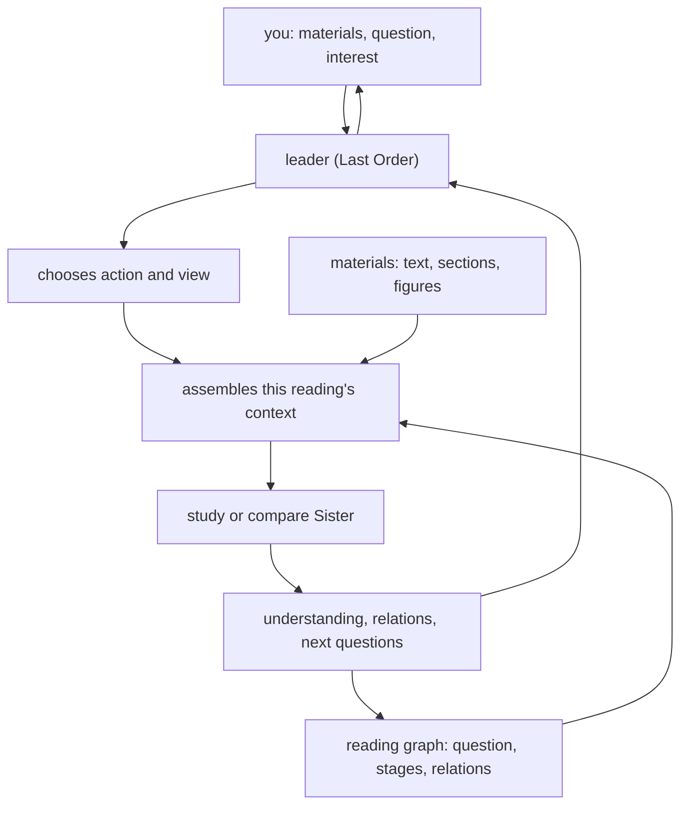
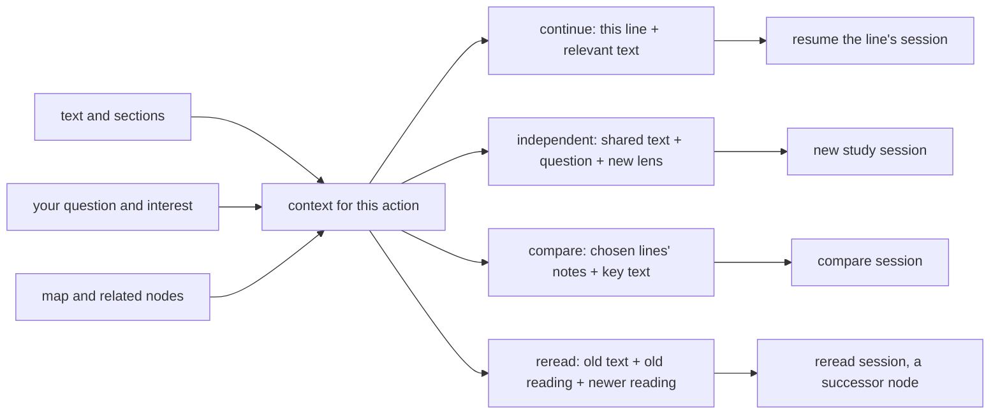
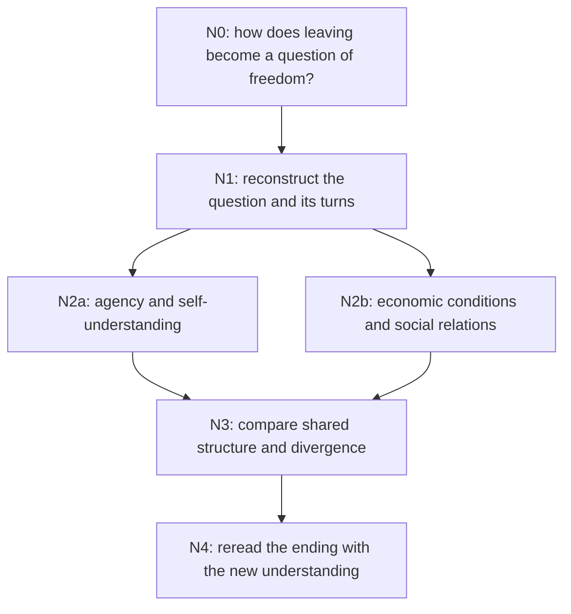

# Reading materials with an agent

Reading mode sits beside research. You give Last Order a few materials and a question, and she
reads with you: reconstructing an argument, asking what a text takes for granted, trying a claim
at another scale, setting two readings against each other, and going back over the earlier pages
once you understand more. What it saves is understanding you can keep using — notes next to the
original, a map of where the reading went, and the questions it opened — not a paper.

It is built for humanities and social-science reading first. The same actions work on a proof,
a technical article, or a design document: only the lens changes.

> Reading mode is part of the source checkout. It needs Node.js and a build step (below). The
> Python wheel and the release archives do not ship the reading engine yet.

## What you need

| Requirement | Why |
|---|---|
| Node.js 22.19.0 or newer | the reading engine is a TypeScript program run with the pi SDK |
| a text model | the model this chat uses, or one named with `--model provider/id` |
| a project folder | materials, `.pageindex/` and `reading/` all live inside it |

Build the engine once, from the repository root:

```sh
npm --prefix packages/reading install    # or: npm --prefix packages/reading ci
npm --prefix packages/reading run build  # tsc → packages/reading/dist/
```

MISAKA looks for `packages/reading/dist/cli.js` in the checkout. `MISAKA_READING_RUNTIME` points
it at another built `cli.js`, and `MISAKA_READING_NODE` at a `node` binary that is not on `PATH`.
If the engine is missing, the command says so and prints the two build lines above.

## Starting a reading

Both entry points drive the same engine: the terminal command and the `/read` command inside a
chat window.

```sh
misaka read open sources/luxun.html sources/dolls-house.txt \
  --question "How do leaving and economic conditions together make up the problem of freedom?"
```

`open` indexes each material (a path, or an HTTP URL it downloads once into the run), writes the
reading folder, and prints the run ID and the entry node. Nothing is sent to a model yet: the
entry node holds your own question.

Inside a chat window, the same subcommands follow `/read`:

```text
/read open sources/luxun.html --question "..."
/read act RUN_ID reconstruct --node N0
/read say RUN_ID  为什么鲁迅先取消两种结局，再谈经济？
/read stop
```

`/read say` and `/read stop` belong to the window: say sends a line to the run's leader in the
chat, stop ends the engine this window started. The graph and the notes stay on disk either way.
Progress appears on the status line and in a small widget above the input box as the agent
writes; `misaka read chat` does the same in a terminal, and Ctrl+C leaves it.

The window keeps one engine across commands, and an engine's model is fixed when it starts.
Naming a different model (`/read say --model provider/id RUN_ID ...`, or any subcommand with
`--model`) restarts the engine with the new handover; the reading resumes from disk, so nothing
already written is lost. `graph` reads files only and takes no `--model`.

The first `/read say` after `open` or `graph` also resolves the chat's selected model.
Explicit `--workspace` or `--runs-dir` selections switch the window to that reading location;
following commands keep using it until another location is selected.

## The commands

Every subcommand takes `--workspace DIR` (default: the current directory), `--runs-dir DIR`
(default: `<workspace>/reading`), `--json` (print only the result object, for scripts) and, where
it calls a model, `--model PROVIDER/ID`.

A runs directory inside the workspace shares the project's document index, so a material you
already added with `misaka doc add` is visible to the run. A runs directory outside the workspace
gets its own index under `<runs-dir>/.pageindex`: files and URLs the run imports are copied into
that run's `sources/` folder and indexed there, and the run still reads project documents too.

| Command | What it does |
|---|---|
| `misaka read open SOURCE... --question Q` | index the materials and create the run; `--intent TEXT` records what you want out of it, `--model` picks the model |
| `misaka read act RUN_ID ACTION --node NODE_ID` | run one action on a node. `--focus "PAGES OR PASSAGE"`, `--lens "VIEW"`, `--context continue\|independent\|compare\|reread`, `--question` to state the action's question yourself |
| `misaka read fork RUN_ID --node NODE_ID --lens "A" --lens "B"` | split one node into independent lines that read in parallel; `--action` chooses the method (default `reconstruct`), `--question` overrides the branch question |
| `misaka read compare RUN_ID NODE_A NODE_B ... --question Q` | a comparison node whose parents are the chosen lines |
| `misaka read reread RUN_ID --node OLD --using NEW` | carry a newer understanding back to older material; `--focus` says where to look |
| `misaka read graph RUN_ID` | print the map and the paths of the node files |
| `misaka read chat RUN_ID` | talk with the run's leader; she can call the actions above herself |

The eight actions:

| Action | What it asks for | What it leaves behind |
|---|---|---|
| `overview` | the author's problem, the shape of the text, where to enter it | a reading map and an entry point |
| `reconstruct` | how a difficulty led to the concepts, constructions and steps taken | a difficulty–choice–advance account |
| `presuppose` | what is treated as natural, and what a choice opened or closed | premises, costs and new questions |
| `transform` | the same object organised another way — another statement, scale or premise | the new statement and what it made visible |
| `compare` | how two or more materials or readings meet | shared structure, where they part, what follows |
| `translate` | how one theory's concepts correspond to another's | a map of the correspondence and its joints |
| `reread` | how a newer understanding changes an earlier reading | a successor understanding |
| `generate` | what is now worth asking | new questions or directions |

There is no required order and no eighth stage. You name the action, or the leader chooses one
and says why. Methods are loaded as explicit skills from `packages/reading/methods/<action>/`
— the guidance the study agent receives for that action, not a template answer.

## How the run is organised



The loop repeats as long as you keep reading. The graph below records where understanding came
from; the loop above is what happens each time.

The leader holds the question and the map and can answer small things herself. She hands a real
line of reading to a study Sister, configured with the action, the lens and the current
question. A comparison goes to a Sister that receives the chosen lines whole. There is no
standing materials clerk, graph keeper or scoring team: the program owns the materials, the
graph and the context.

Four context modes decide what actually reaches the agent:

| Mode | What is handed over |
|---|---|
| `continue` | this line's current understanding, the relevant text, its terms; the line's own session is resumed |
| `independent` | the shared materials and question plus the new lens; other lines' conclusions are withheld, and a new session is created |
| `compare` | the full node notes of the chosen lines, their terms and the materials they cited |
| `reread` | the old material and old understanding, plus the newer understanding you name |



A branch is independent only because it gets a fresh session, not because a summary was left out
of one prompt.

## Where the run is stored

```text
reading/<run-id>/
  graph.json           nodes, generation edges, content relations, sources, session index
  graph.md             the same graph as Mermaid, plus a short entry for every node
  reading.md           the question, the map, and where to continue
  reader.md            your stated interest and preferences
  nodes/<node-id>.md   the staged understanding itself
  sessions/            the leader's and the study lines' pi sessions
  sources/             copies or downloads of materials from outside the project
```

`graph.json` is the run's state; everything else is derived from it or points into it. Only the
engine writes this folder. Materials stay in the project's `.pageindex/`, so a document indexed
with `misaka doc` is read directly and is not copied into a second library. Files outside the
project, and URLs, are copied into `reading/<run>/sources/` first and indexed from there; the
original path is kept in `graph.json` and shown in `reading.md`.

Each node keeps its ID, question, lens, material references, the path of its body, a short
summary, the actions that formed it, the questions it opened and its reading line. Detail that
belongs to the current stage is appended to the current node; a new question, a new lens, a
comparison or a reread creates a successor node, and the earlier one stays as it was.

Two kinds of edge:

- **generation** — `continue`, `fork`, `compare`, `reread`. They say where an understanding came
  from and form a DAG; a comparison has one parent per route.
- **content relations** — `corresponds`, `differs`, `shares-concept`, `depends-on`,
  `resonates`. They are for reading and navigation and never order the work.

### A route through two texts

This is the shape the method produces on a humanities question — a sketch of what a run looks
like, not a stored result:



The two lines reach a comparison together; nothing promises they will end as one explanation. In
a real run the labels are your question and lenses, and every node links to its body and to the
pages it used.

## Continuing later

Nothing has to stay running. `misaka read graph RUN_ID` and any other command reopen the run
from `graph.json`; `misaka read chat RUN_ID` reopens the leader's saved session, and each study
line resumes its own. `misaka read chat` then lets you ask the leader to act: she has the same
`act`, `fork`, `compare` and `reread` operations as tools, and the map she is shown is written by
the program, not guessed. In the window, the engine stays alive between commands so a line can
be continued turn by turn; `/read stop` ends it and leaves the run on disk.

If the engine exits badly, the command returns an error; the graph and sessions written so far
remain, so the next command picks up from them.

## Models and limits

The leader and study Sisters use a text model. In a window, `/read` starts from the model the
chat is using (`ctx.model`), through the same provider settings, unless you pass `--model`. In
the terminal, `--model` or the profile's pinned model is used, falling back to an API route
configured in the process environment. Provider objects from the Python side are not serialised; the engine
receives a provider, model id, base URL, API style, headers and a runtime key, and registers them
for this run. The key is never written to the graph, a note or a log.

For a terminal API route, set `MISAKA_READING_BASE_URL`, `MISAKA_READING_API_KEY`,
`MISAKA_READING_MODEL` and, when needed, `MISAKA_READING_API` (for example,
`openai-completions`). A command started inside Claude Code may inherit proxy settings that
another terminal does not have; reading mode does not automatically load Claude Code's settings.
The route's API must be supported by the pi SDK; Python-only provider implementations do not
cross the process boundary.

Long material is read in pages: the agent asks for an outline, then pages or a section, rather
than receiving the whole book at once. Source identifiers are matched to the registered materials;
page locations are the model's declarations, and quoted sentences are not automatically checked.

Reading mode does not start a research run by itself. When you want the reading to become a
paper, take the notes into `/research` yourself with your own question.

## Trying it

`examples/reading/` holds a short sources file and the commands that turn it into a run, and
`scripts/run_reading_demo.sh` (or `.ps1` on Windows) runs the whole chain — open, reconstruct,
fork, compare, reread, graph, and a check that chat resumes the run — printing the run ID and the
node files it wrote.
