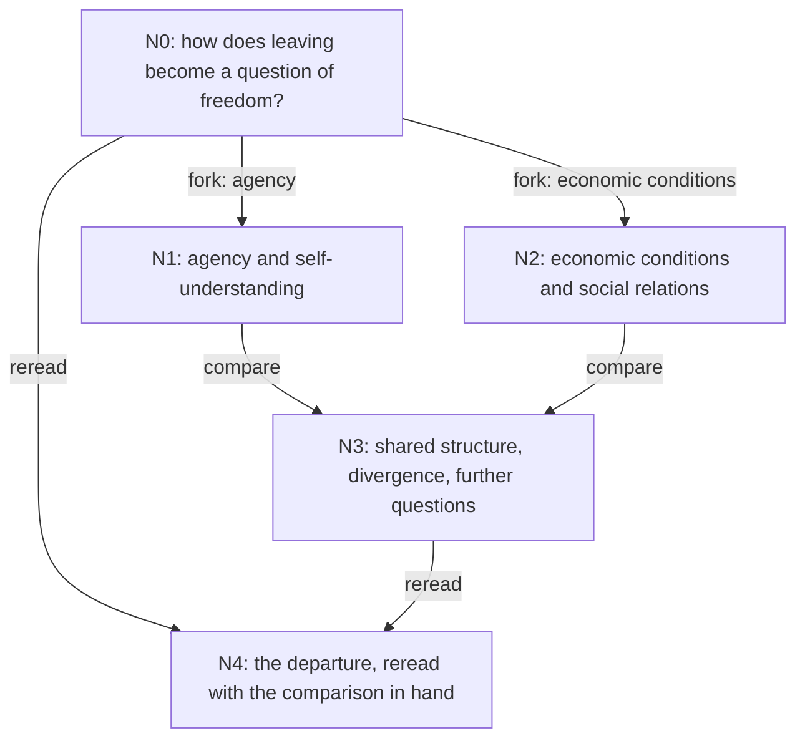

# Reading with Last Order

Reading mode sits beside research. You give Last Order a few materials and a question, and she
reads with you: reconstructing an argument, asking what a text takes for granted, trying a claim
at another scale, setting two readings against each other, and going back over earlier pages once
you understand more. What it keeps is understanding you can go on using -- notes beside the
original, a map of where the reading went, and the questions it opened -- not a paper.

It is built for humanities and social-science reading first. The same actions work on a proof, a
technical article or a design document: only the lens changes.

This page covers opening a reading, the reading actions, how Last Order leads it, continuing later,
and what a reading leaves in your project; it is also in [简体中文](reading.zh-CN.md). For answering
a question with a full research design, see [Research runs](research.md).

## Opening a reading

In Last Order's window:

```text
/read open sources/luxun.pdf https://example.org/dolls-house.html --question "How do leaving and economic conditions together make up the problem of freedom?" --intent "I care about money and agency"
```

`open` adds each material, makes the reading's folder and its entry node `N0` (your question), and
calls no model. **This window now leads the reading**: talk to Last Order as usual, and she reads
with you, using the reading tools below.

A material is a file or an http(s) URL:

- a file in the project is indexed where it is;
- a file outside the project, or a URL, is copied into the reading's `sources/` first and indexed
  there (into the project's `downloads/` when the reading's folder is outside the project); the
  original path or URL is kept as its origin. A download may be up to 64 MB, and a copy never
  overwrites another file. The same material given twice is one material.

Every material is then read through the project's document index, with the same tools Last Order
and the Sisters use ([Documents and the web](sources.md)).

From a terminal, `misaka read open SOURCE... --question "..."` does the same and prints the
reading's ID; `misaka read chat RUN_ID` then talks with its leader (below).

## The reading actions

An action is one deliberate operation on the material, done by a **study reader**: a session of its
own, given the method of that action and the material through the document tools. Actions can be
repeated and combined in whatever order the question calls for.

| Action | What it does |
|---|---|
| `overview` | finds the author's problem, the text's construction and a way in |
| `reconstruct` | follows the difficulty, the choices it prompted and where they took the argument |
| `presuppose` | asks what the argument takes as natural, whom it leaves out, what it opens and closes |
| `transform` | changes a wording, scale or premise to make another side of the object visible |
| `compare` | brings readings or materials together: shared structure, divergence, further questions |
| `translate` | carries a statement into another theory's terms, and says where it stops holding |
| `reread` | returns to earlier material with newer understanding |
| `generate` | develops the questions a reading opens, and how to start on each |

A study reader quotes only text the document tools gave it, in the text's own language, checks its
quotations with `doc_verify`, keeps what the text says apart from its own reconstruction and
questions, and submits its reading with the places it cites, the concepts it turned on, its
relations to other nodes, and the questions it opened. Nobody watches a study reader turn by turn,
so MISAKA's guards against a session repeating itself or spinning on its tools watch it, as they
watch every headless session.

## How Last Order leads

The window that opened a reading leads it, as the window that starts a research run leads that
run. While it does, two things hold in that conversation:

- **Last Order is given the reading-mode notice**: the question, your stated interest, the materials
  and the map, written from the reading's graph. It follows your next message; after that, whenever
  the reading has changed (her actions, yours, another window's), the new map follows your next
  message. Earlier notices stay where they were, so the conversation's history is never rewritten:
  her earlier reasoning stays valid for models that check it, and the cached prefix holds. A notice
  a compaction summarized is given again whole, and when the window stops leading the reading she is
  told so;
- **the reading tools are active**: `reading_act`, `reading_fork`, `reading_compare` and
  `reading_reread`.

Last Order answers small questions of explanation herself and sends real reading to study
readers. After each operation her tool tells her what it wrote -- each node's summary and further
questions, and the reading itself -- so she connects the lines from what they found, not from a
sentence. What reaches a study reader depends on the operation:

| Operation | Context | Session |
|---|---|---|
| act, without a lens | this node's note, the relevant text and the method | the node's own session, resumed |
| act with a lens, or a fork | the material, the question and the new lens; other lines' conclusions are withheld | a fresh session per line |
| compare | the full notes of the chosen nodes and the material they cite | a fresh comparison session |
| reread | the earlier note and material, with the newer notes you name | a fresh session |

A line is independent because it gets a fresh session, not because a summary was left out of one
prompt. A fork's lines are read in parallel; a line that fails is reported after the others are
written.

You can also run an action yourself from the window, for example:

```text
/read act RUN_ID presuppose --node N1 --focus "the last pages"
/read fork RUN_ID --node N0 --lens agency --lens "economic conditions"
/read compare RUN_ID N1 N2 --question "What do the two lines share?"
/read reread RUN_ID --node N0 --using N3
```

An action with `--lens` starts a new, independent line, as Last Order's does; `--context` chooses
another mode explicitly. Progress shows above the input box and on the status line. `/read stop`
stops the running operation, whether you or Last Order started it (her turn stops with it, as
Escape stops it), and a stopped operation writes nothing, not even into a line's session. One
operation runs at a time on a reading, from any window or terminal.

## The reading graph

Every action writes onto a node. An action without a lens deepens the node it acts on: its reading
is appended to the node's note. A lens, a fork, a comparison or a rereading writes a **successor
node**, and the earlier node stays as it was, so returning to a text keeps the history of its
interpretation.

Two kinds of edge connect the nodes:

- **generation** (`fork`, `compare`, `reread`): where an understanding came from. They form a DAG;
  a comparison has one parent per compared node, a rereading has the earlier node and the newer
  ones. The graph refuses a cycle.
- **relations** (`corresponds`, `differs`, `shares-concept`, `depends-on`, `resonates`,
  `contradicts`): what one reading says about another. They are for reading and navigation and
  never order the work.



## Continuing later

Nothing has to stay running. Reopen the leading conversation (the sidebar lists it under sessions,
or `/resume`), and the reading is still bound to it: tools, notice and map come back with it.
`/read chat RUN_ID` takes a reading up from another window of the same project (a window leads
only a reading of its own project, whose documents its tools can open): it tells you which
conversation leads the reading, and `/read chat RUN_ID --here` makes this window the leader (Last
Order here will not remember the earlier conversation). Opening or taking up another reading hands
the first one back, and `/read close` leaves reading mode; the reading stays on disk. A window
started without a session keeps no conversation to resume, so it cannot lead a reading.

From a terminal, `misaka read chat RUN_ID` talks with the reading's leader in the conversation that
leads it, one turn per line of input (a pipe works too); `/stop` or `/quit` leaves at once, and the
end of input leaves once the lines before it have run. It exits with status 1 if a turn failed.
While that conversation is open in a window, it refuses and names the conversation, so two programs
never write one conversation; `misaka chat --attach --session PATH` joins the window instead. A
continued node resumes its own study session either way.

## Commands

| To | In the window | From the shell |
|---|---|---|
| open a reading | `/read open SOURCE... --question Q [--intent T]` | `misaka read open SOURCE... --question Q [--intent T]` |
| do one action | `/read act RUN_ID ACTION --node N [--lens L] [--focus F] [--context MODE] [--question Q]` | `misaka read act ...` |
| fork into lines | `/read fork RUN_ID --node N --lens A --lens B [--action ACT]` | `misaka read fork ...` |
| compare nodes | `/read compare RUN_ID N1 N2 ... --question Q` | `misaka read compare ...` |
| reread | `/read reread RUN_ID --node OLD --using NEW [--focus F]` | `misaka read reread ...` |
| see the graph | `/read graph RUN_ID` | `misaka read graph RUN_ID` |
| lead a reading | `/read chat RUN_ID [--here]` | `misaka read chat RUN_ID` |
| leave reading mode | `/read close` | (the conversation stays the leader) |
| stop an operation | `/read stop` | Ctrl+C |

`open` and `graph` call no model (they accept `--model` all the same, so one command line serves
every subcommand). The reading operations (`act`, `fork`, `compare`, `reread`) use the window's
model, or `--model provider/id`; from the shell, `MISAKA_READING_MODEL` when no `--model` is given,
else Last Order's own model. `chat` keeps the model of the conversation that leads the reading
unless you give `--model`; the variable does not change it. `--json` prints
only the result object on stdout, on one line; for `chat` it prints one line per turn, with her
reply and whether the turn succeeded, while her text goes to stderr. `--runs-dir` puts a new
reading's folder somewhere other than `<project>/reading/`.

## What a reading writes

```text
<project>/reading/<run-id>/
  graph.json        the graph as data: nodes and their lines, generation edges, relations,
                    materials, the session index (the leader's conversation and each node's
                    study session), and the model each action used
  graph.md          the same graph in Mermaid, with an entry for every node
  reading.md        the question, where the reading stands, and where to go on
  reader.md         your stated interest
  nodes/<id>.md     the readings themselves, one section per action
  sessions/         the study readers' sessions, one per node
  sources/          copies of materials from outside the project
```

The reading itself is kept in MISAKA's home, as a graph whose every change is on record, the text
each action wrote included: an action is recorded whole or not at all. Everything in the folder
except `sessions/` and `sources/` is rewritten from it after every change, the notes too, so leave
those files unedited; if one cannot be written (a file held open by another program, say), the next
change writes it again. Like a research run, a reading belongs to the project folder it was opened
in, at the path it had then.

## Models and limits

A study reader uses the model of the window that runs the operation, unless the command names one
with `--model`; from the shell, `--model`, then `MISAKA_READING_MODEL`, then Last Order's own model.
(Last Order's own conversation keeps its model; the variable is for the study readers only.)
Either is a model MISAKA already knows (`provider/id`, or an id alone), through the same sign-ins
and model settings as everything else ([Models](models.md)); a reading has no route of its own,
and no key is written to the graph, a note or a log.

Material is read in pages, never handed over whole: each action starts with an opening window of
up to 8,000 characters from each of up to three materials, preferring the places it cites, and the
reader asks for more through the document tools. A continued node is handed the newest whole
sections of its note that fit 12,000 characters; a comparison or a rereading gets whole notes. A
study reader is asked to check every quotation with `doc_verify` before it uses it; places that
name a material the reading does not have are dropped. A download may be up to 64 MB and take up
to five minutes.

Reading mode does not start a research run. When a reading should become a paper, take its notes
into `/research` with your own question.

## Trying it

`examples/reading/` names two public texts and a question (Lu Xun's lecture on what happens after
Nora leaves, and Ibsen's *A Doll's House*), and `scripts/run_reading_demo.sh` (`.ps1` on Windows)
runs the whole chain on them: open, reconstruct, fork, compare, reread, the graph, and a chat with
the leader that a second process resumes. It prints every command, the reading's ID and the notes
it wrote; give it a scratch folder.

## Switching it off

Reading mode is a bundled extension of Last Order's window. To switch it off, add
`"-builtin:reading"` to `extensions` in `~/.misaka/settings.json` (or a trusted project's
`.misaka/settings.json`); see [Configuration](../reference/configuration.md). This takes reading
mode out of the window; `misaka read` in a terminal still works.
