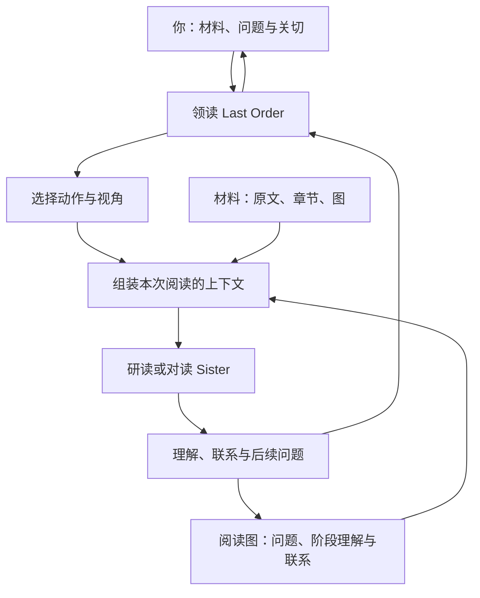
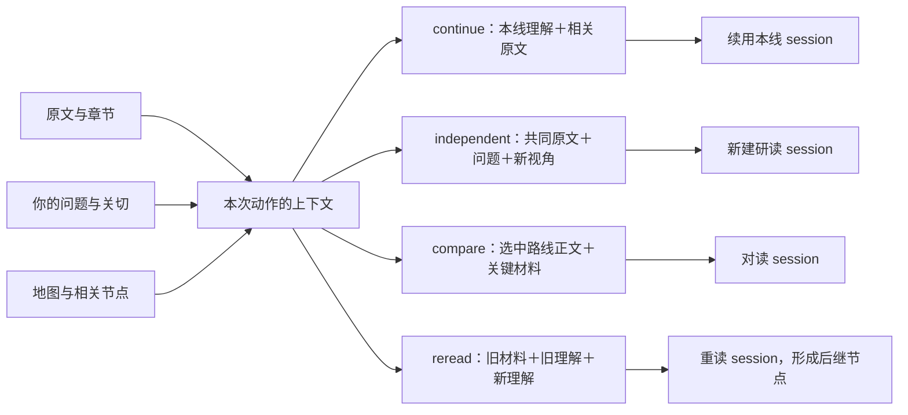
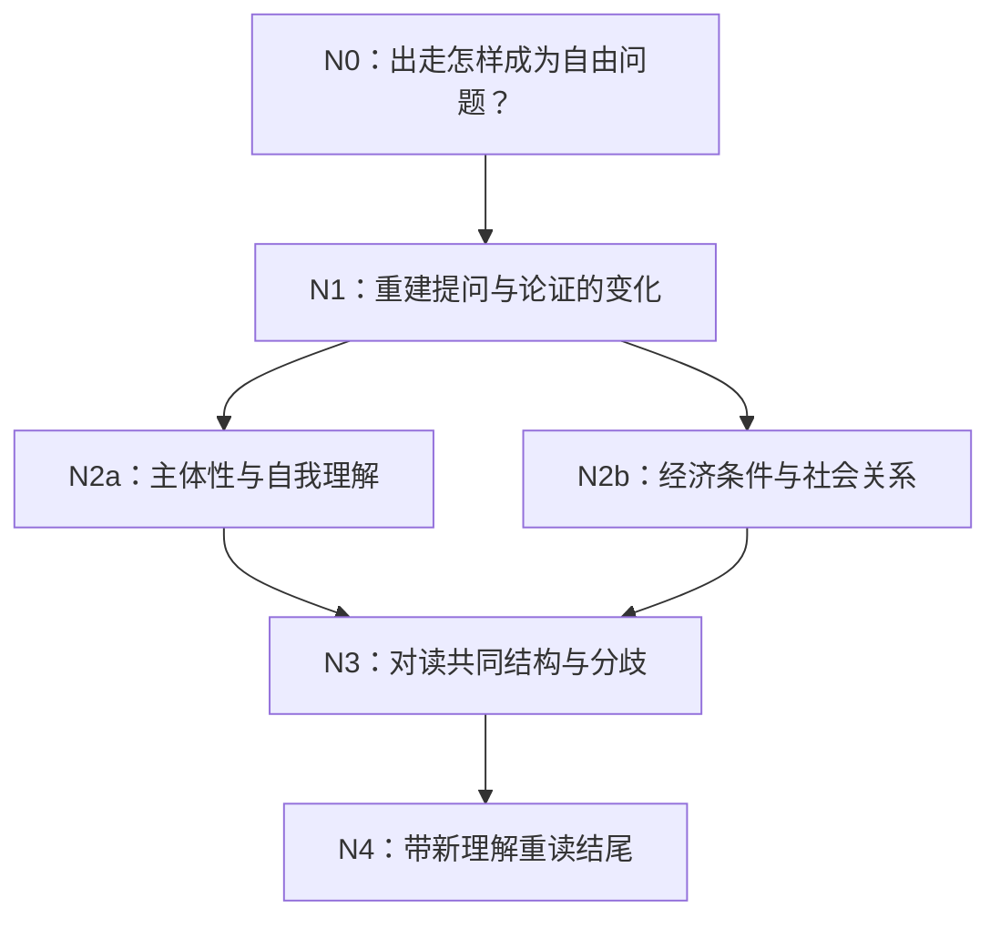

# 与 Agent 共读材料

阅读模式与研究模式并列。你交给 Last Order 几份材料和一个问题，她与你一起读：重建论证、追问什么被当成了自然、换一种尺度或表述再看、把两条读法摆在一起、在理解变化之后回到前面重读。留下的是可以继续使用的理解——原文旁的笔记、一张阅读地图，以及读出来的新问题——而不是一篇论文。

它首先面向人文社科阅读；同样的动作也可以处理一个证明、一篇技术文章或一份设计文档，变的只是视角。

> 阅读模式目前属于源码检出。需要 Node.js 并先构建引擎（见下文）。Python wheel 与发布压缩包尚未包含阅读引擎。

## 需要的条件

| 条件 | 原因 |
|---|---|
| Node.js 22.19.0 或更新 | 阅读引擎是用 pi SDK 编写的 TypeScript 程序 |
| 一个文本模型 | 默认用当前对话框使用的模型，也可用 `--model provider/id` 指定 |
| 一个项目目录 | 材料、`.pageindex/` 与 `reading/` 都放在其中 |

在仓库根目录构建一次引擎：

```sh
npm --prefix packages/reading install    # 或：npm --prefix packages/reading ci
npm --prefix packages/reading run build  # tsc → packages/reading/dist/
```

MISAKA 默认在源码检出中查找 `packages/reading/dist/cli.js`；`MISAKA_READING_RUNTIME` 可指向别处已构建的 `cli.js`，`MISAKA_READING_NODE` 可指向不在 `PATH` 上的 `node`。找不到引擎时，命令会直接报出路径并打印上面两行构建命令。

## 开始一次阅读

两个入口驱动同一个引擎：终端命令与对话窗口里的 `/read`。

```sh
misaka read open sources/luxun.html sources/dolls-house.txt \
  --question "个人出走与经济条件如何共同构成自由问题"
```

`open` 会为每份材料建立索引（本地路径，或由它下载一次到本次阅读目录的 HTTP 地址），写出阅读目录，并打印运行 ID 与入口节点。此时还没有调用模型：入口节点装的是你自己的问题。

在对话窗口里，子命令跟在 `/read` 之后：

```text
/read open sources/luxun.html --question "..."
/read act RUN_ID reconstruct --node N0
/read say RUN_ID  为什么先取消两种结局，再谈经济？
/read stop
```

`/read say` 与 `/read stop` 属于窗口：say 把一句话交给这次阅读的领读，stop 结束本窗口启动的引擎。无论停不停，图与节点正文都留在磁盘上。Agent 写作时，进度显示在状态栏和输入框上方的小部件里；终端中 `misaka read chat` 同理，Ctrl+C 退出。

窗口在多次命令之间复用一个引擎，而引擎的模型在启动时就固定了。指定另一个模型（`/read say --model provider/id RUN_ID ...`，或任一子命令加 `--model`）会按新的模型重启引擎；阅读从磁盘续上，已经写入的内容不会丢失。`graph` 只读文件，不接受 `--model`。

在 `open` 或 `graph` 之后第一次 `/read say`，也会取得聊天窗口选中的模型。显式指定 `--workspace` 或 `--runs-dir` 会切换阅读位置，随后未指定位置的命令沿用该选择。

## 命令

每个子命令都接受 `--workspace DIR`（默认当前目录）、`--runs-dir DIR`（默认 `<workspace>/reading`）、`--json`（只打印结果对象，便于脚本接续）；需要模型的操作另有 `--model PROVIDER/ID`。

阅读目录在工作区内时，与项目共用同一份文档索引，你用 `misaka doc add` 加过的材料读者也能看到。阅读目录在工作区外时，则在 `<runs-dir>/.pageindex` 下另有一份索引：本次阅读导入的文件与 URL 会先复制到该 run 的 `sources/`，再在那里建索引；项目里的文档同样照常可读。

| 命令 | 作用 |
|---|---|
| `misaka read open SOURCE... --question Q` | 为材料建索引并建立本次阅读；`--intent TEXT` 记录你想得到什么，`--model` 指定模型 |
| `misaka read act RUN_ID ACTION --node NODE_ID` | 在一个节点上执行一个动作。`--focus "页段或段落"`、`--lens "视角"`、`--context continue\|independent\|compare\|reread`；`--question` 可自行给出本次动作的问题 |
| `misaka read fork RUN_ID --node NODE_ID --lens "甲" --lens "乙"` | 把一个节点分成并行阅读的独立路线；`--action` 选择方法（默认 `reconstruct`），`--question` 覆盖分支问题 |
| `misaka read compare RUN_ID NODE_A NODE_B ... --question Q` | 建立一个对读节点，父节点为选中的路线 |
| `misaka read reread RUN_ID --node OLD --using NEW` | 带着较新的理解回到旧材料；`--focus` 指定重读位置 |
| `misaka read graph RUN_ID` | 打印阅读地图与各节点正文的位置 |
| `misaka read chat RUN_ID` | 与该次阅读的领读交谈；她可以自己调用上面的动作 |

八类动作：

| 动作 | 追问什么 | 留下什么 |
|---|---|---|
| `overview` 概览 | 作者的问题、文章结构、从哪里进入 | 阅读地图与入口 |
| `reconstruct` 重建 | 困难如何引出概念、构造与论证步骤 | 困难—选择—推进的解释 |
| `presuppose` 追问前提 | 什么被当成自然；某个选择打开或收窄了什么 | 前提、得失与新问题 |
| `transform` 换表述 | 同一对象换一种陈述、尺度或前提来组织 | 新表述及它让什么变清楚 |
| `compare` 对读 | 几份材料或几种理解怎样相遇 | 共同结构、分歧所在与后续问题 |
| `translate` 转译 | 一套理论的概念如何对应另一套 | 对应地图与连接点 |
| `reread` 重读 | 新理解怎样改变先前的阅读 | 后继理解节点 |
| `generate` 生成 | 现在的理解引出什么值得问的问题 | 新问题或构造方向 |

没有规定的先后顺序，也不要求走完八步。你可以直接指定动作，也可以由领读选择并说明理由。方法说明是从 `packages/reading/methods/<action>/` 显式加载的 skill，是研读 Agent 这次收到的指引，不是预先写好的答案模板。

## 一次阅读怎样组织



只要还在读，这个循环就继续。下面的图记录理解从哪里来；上面的循环是每一次动作实际发生的事。

领读掌握问题与地图，小问题可以自己回答，真正的一条阅读线交给研读 Sister，配置为“动作＋视角＋当前问题”。对读由收到完整路线的 Sister 承担。这里没有常驻的材料员、图管理员或评分团队：材料、图和上下文都由程序掌管。

四种上下文方式决定实际交到 Agent 手里的内容：

| 方式 | 交接内容 |
|---|---|
| `continue` | 本条阅读线的当前理解、相关原文与术语；续用该线自己的 session |
| `independent` | 共同的原文与问题，加上新视角；不附其他路线的结论，并新建 session |
| `compare` | 选中路线的完整节点笔记、术语及其引用材料 |
| `reread` | 旧材料、旧理解，以及你指定带回的新理解 |



一条路线之所以独立，是因为它用了新的 session，而不是因为在某次提示里删掉了摘要。

## 阅读存在哪里

```text
reading/<run-id>/
  graph.json           节点、生成边、内容关系、材料与 session 索引
  graph.md             同一张图的 Mermaid 版本，附每个节点的入口
  reading.md           问题、理解地图与继续阅读的入口
  reader.md            你明确表达的关切与偏好
  nodes/<node-id>.md   阶段理解正文
  sessions/            领读与各研读线的 pi session
  sources/             从项目外复制或下载到本次阅读的材料
```

`graph.json` 是一次阅读的状态，其余文件由它派生或指向它。这个目录只由引擎写入。材料仍然放在项目的 `.pageindex/` 中：用 `misaka doc` 索引过的文档直接读取，不会另建第二个文献库。项目外的文件与 URL 先复制到 `reading/<run>/sources/` 再建索引，原始路径记在 `graph.json` 里并显示在 `reading.md` 中。

每个节点保存 ID、问题、视角、材料引用、正文位置、简短摘要、形成它的动作、它引出的问题，以及所属阅读线。属于当前阶段的细节补充写在当前节点；出现新问题、新视角、对读或重读形成新的阶段理解时，才建立后继节点，旧节点保持原样。

两类边：

- **生成边**——`continue`、`fork`、`compare`、`reread`。说明理解从哪里来，构成 DAG；对读节点每条路线各有一个父节点。
- **内容关系**——`corresponds`、`differs`、`shares-concept`、`depends-on`、`resonates`。用于阅读与导航，不决定执行先后。

### 一条人文对读路线

这是方法在一个问题上产生的形状，是路线示意，不是已经存下的结果：



两条路线共同到达一个对读节点，并不保证最后合成同一个解释。真实运行里，节点标签是你的问题与视角，每个节点都指回自己的正文和用到的页段。

## 以后继续

不需要一直开着什么。`misaka read graph RUN_ID` 以及其他命令都会从 `graph.json` 重新打开这次阅读；`misaka read chat RUN_ID` 会恢复领读保存的 session，每条研读线恢复各自的 session。`misaka read chat` 里可以让领读动手：她拥有与命令行相同的 `act`、`fork`、`compare`、`reread` 工具，而她看到的地图由程序写入，不是她自己猜的。在对话窗口里，引擎在多次命令之间保持存活，可以逐轮推进一条线；`/read stop` 结束引擎，阅读仍留在磁盘上。

如果引擎非正常退出，当前命令会返回错误；已经写出的图与 session 仍保留，下一条命令从它们继续。

## 模型与限制

领读和研读 Sister 都使用文本模型。在窗口里，`/read` 默认从当前对话使用的模型（`ctx.model`）出发，沿用同一套 provider 设置；也可以用 `--model` 另选。在终端里，使用 `--model` 或角色配置里固定的模型，否则用当前进程环境中的 API 路由。Python 侧的 provider 对象不会被序列化：引擎收到的是 provider 名、模型 ID、base URL、API 风格、请求头与本次运行用的 key，只在本次运行里注册。key 不会写进图、笔记或日志。

终端使用 API 路由时，设置 `MISAKA_READING_BASE_URL`、`MISAKA_READING_API_KEY`、`MISAKA_READING_MODEL`，必要时再指定 `MISAKA_READING_API`（例如 `openai-completions`）。Claude Code 内启动的命令可能继承其代理环境，另一个终端则没有；阅读模式不会自动加载 Claude Code 的配置。路由所用 API 需由 pi SDK 支持，Python 专有 provider 实现不会跨进程带入。

长材料按页读取：Agent 先要纲要，再要页段或某个章节，而不是一次收到整本书。来源 ID 会匹配到已登记材料；页码仍是模型的声明，不会自动逐句核对引文。

阅读模式不会自行启动研究。当你希望这些阅读成果变成文章时，带着笔记到 `/research` 中提出你自己的问题。

## 试一试

`examples/reading/` 中有一份简短的材料清单和把清单变成一次阅读的命令；`scripts/run_reading_demo.sh`（Windows 下为 `.ps1`）跑完整条链——open、reconstruct、fork、compare、reread、graph，再检查 chat 能恢复这次阅读——并打印运行 ID 与写出的节点文件。
