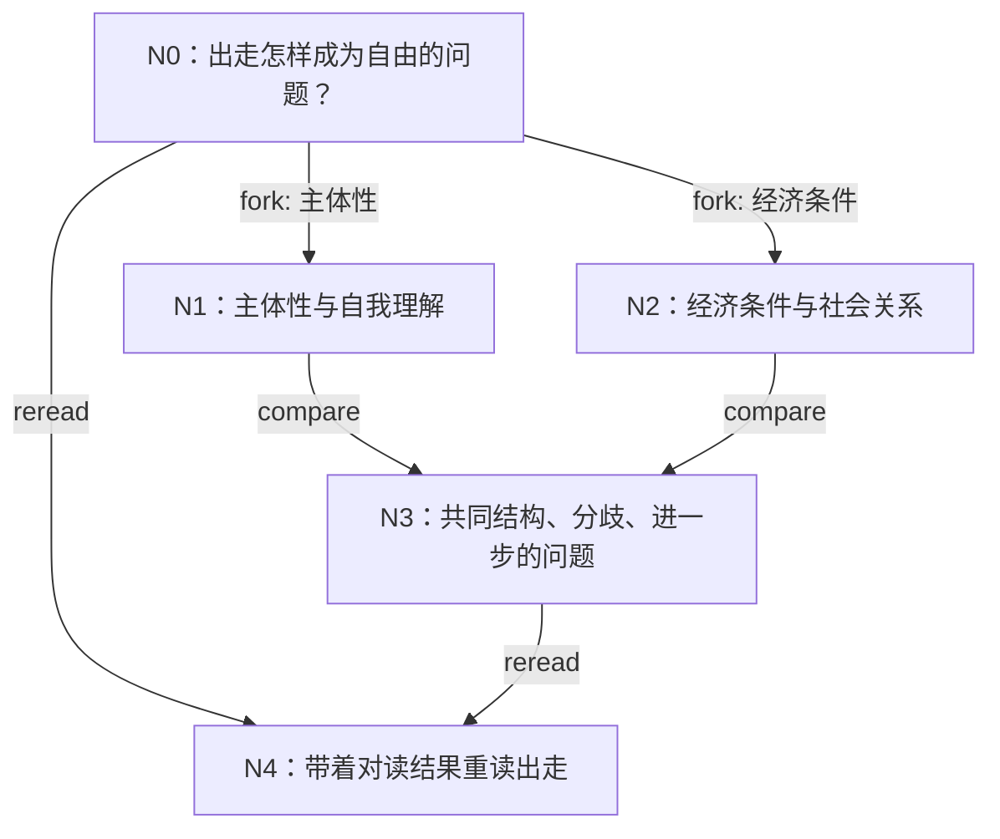

# 与 Last Order 共读

[English](reading.md)

阅读模式和研究模式并列。你给 Last Order 几份材料和一个问题，她陪你一起读：重建一段论证、追问文本把什么当作
理所当然、换一个尺度检验一个说法、把两种读法放在一起对照，并在理解加深之后回头重读前面的文字。它留下的是可以
继续用的理解——写在原文旁边的笔记、一张阅读走向的地图、读出来的新问题——而不是一篇论文。

它首先为人文社科阅读而设计。同样的动作也适用于证明、技术文章或设计文档，变的只是视角。

本页介绍如何打开一次阅读、有哪些阅读动作、Last Order 怎样领读、之后怎样接着读，以及阅读会在项目里留下什么。
如果要用完整的研究设计回答一个问题，请看[研究模式](research.md)（英文）。

## 打开一次阅读

在 Last Order 的窗口里：

```text
/read open sources/luxun.pdf https://example.org/dolls-house.html --question "个人出走与经济条件如何共同构成自由问题？" --intent "我关心钱和主体性"
```

`open` 加入每份材料，建立这次阅读的文件夹和入口节点 `N0`（你的问题），不调用任何模型。**此后这个窗口就是
这次阅读的领读**：像平常一样和 Last Order 说话，她会用下面的阅读工具陪你读。

材料可以是文件，也可以是 http(s) 网址：

- 项目内的文件在原处建立索引；
- 项目外的文件或网址，先复制到这次阅读的 `sources/` 再建立索引（阅读文件夹在项目外时，复制到项目的
  `downloads/`）；原来的路径或网址记为它的来源。下载上限 64 MB，复制永远不会覆盖已有文件。同一份材料给两次，
  只算一份。

之后每份材料都通过项目的文档索引来读，用的是 Last Order 和 Sisters 平常用的同一套工具
（[文档与网络](sources.md)，英文）。

在终端里，`misaka read open SOURCE... --question "..."` 做同样的事，并打印这次阅读的 ID；然后用
`misaka read chat RUN_ID` 和它的领读对话（见下文）。

## 阅读动作

一个动作是对材料的一次有意的操作，由**研读者**完成：研读者是一个独立的会话，拿到这个动作的方法，并通过文档
工具读材料。动作可以重复、可以按问题需要以任何顺序组合。

| 动作 | 做什么 |
|---|---|
| `overview` | 找出作者的问题、文本的构造和进入的入口 |
| `reconstruct` | 跟随困难、它引出的选择，以及这些选择把论证带到了哪里 |
| `presuppose` | 追问论证把什么当作自然、把谁排除在外、打开了什么又关上了什么 |
| `transform` | 改变措辞、尺度或前提，让对象的另一面显出来 |
| `compare` | 把几种读法或几份材料放在一起：共同的结构、分歧、进一步的问题 |
| `translate` | 把一个陈述转换成另一种理论的语言，并说明它在哪里不再成立 |
| `reread` | 带着更新的理解回到前面的材料 |
| `generate` | 展开一次阅读打开的问题，以及每个问题从哪里入手 |

研读者只引用文档工具交给它的文本，用文本自己的语言引用，用 `doc_verify` 核对引文，把文本说了什么与它自己的
重建和追问分开，并在提交阅读时附上所引的位置、所依赖的概念、与其他节点的关系，以及打开的新问题。没有人逐轮
盯着研读者，所以和所有无人值守的会话一样，由 MISAKA 的守卫防止它重复自己或在工具上空转。

## Last Order 怎样领读

打开阅读的窗口就是它的领读，就像发起研究的窗口领着那次研究。领读期间，这段对话里有两件事成立：

- **Last Order 会收到阅读模式说明**：问题、你说明的关切、材料和地图，都由阅读的图写成。它跟在你下一条消息
  之后；此后只要阅读有了变化（她的动作、你的动作、别的窗口的动作），新地图就跟在你的下一条消息之后。之前的
  说明留在原处，对话历史从不被改写：对会核对自身先前推理的模型来说，她之前的推理依然有效，缓存的前缀也保得住。
  被压缩掉的说明会完整地重新给一次；窗口不再领读时，也会告诉她；
- **阅读工具处于启用状态**：`reading_act`、`reading_fork`、`reading_compare` 和 `reading_reread`。

小的解释性问题 Last Order 自己回答，真正的阅读交给研读者。每次操作之后，工具会告诉她写下了什么——每个节点的
摘要和进一步的问题，以及阅读本身——让她根据各条线读到的东西来联结，而不是根据一句话。研读者拿到什么，取决于
操作：

| 操作 | 上下文 | 会话 |
|---|---|---|
| 不带视角的 act | 这个节点的笔记、相关文本和方法 | 节点自己的会话，接着用 |
| 带视角的 act，或分叉 | 材料、问题和新视角；不给其他线的结论 | 每条线一个新会话 |
| compare | 所选节点的完整笔记和它们引用的材料 | 一个新的对读会话 |
| reread | 早先的笔记和材料，加上你指定的较新笔记 | 一个新会话 |

一条线之所以独立，是因为它拿到的是新会话，而不是因为某个提示里少放了一段摘要。分叉的各条线并行阅读；某条线
失败时，其他线照样写入，失败的那条随后报告。

你也可以在窗口里自己发起动作，例如：

```text
/read act RUN_ID presuppose --node N1 --focus "最后几页"
/read fork RUN_ID --node N0 --lens 主体性 --lens "经济条件"
/read compare RUN_ID N1 N2 --question "两条线有什么共同之处？"
/read reread RUN_ID --node N0 --using N3
```

带 `--lens` 的动作会开出一条新的独立线，和 Last Order 的做法一样；用 `--context` 可以明确指定别的方式。进度
显示在输入框上方和状态栏里。`/read stop` 停止正在进行的操作，不论是你还是 Last Order 发起的（她这一轮也随之
停止，和按 Escape 一样）；被停止的操作什么都不写，连线的会话也不写。同一次阅读同一时间只运行一个操作，不论
来自哪个窗口或终端。

## 阅读图

每个动作都写到一个节点上。不带视角的动作加深它所作用的节点：它的阅读追加到节点的笔记里。视角、分叉、对读或
重读会写出一个**后继节点**，早先的节点保持原样，所以回到一段文本时，对它的诠释历史也保留着。

节点之间有两种边：

- **生成边**（`fork`、`compare`、`reread`）：一个理解从哪里来。它们构成有向无环图；对读的每个被比较节点都是
  它的父节点，重读的父节点是早先的节点和较新的节点。图会拒绝成环。
- **关系**（`corresponds`、`differs`、`shares-concept`、`depends-on`、`resonates`、`contradicts`）：一次
  阅读对另一次阅读说了什么。它们用于阅读和导航，从不决定工作顺序。



## 之后接着读

不需要一直开着。重新打开领读的那段对话（侧栏的会话列表里有它，或用 `/resume`），阅读仍绑定在上面：工具、
说明和地图都随之回来。`/read chat RUN_ID` 可以从同一项目的另一个窗口接手一次阅读（窗口只领读本项目的阅读，
因为它的工具只能打开本项目的文档）：它会告诉你哪段对话在领读；`/read chat RUN_ID --here` 让这个窗口成为
领读（这里的 Last Order 不会记得之前那段对话）。打开或接手另一次阅读，会把前一次交还；`/read close` 离开
阅读模式，阅读留在磁盘上。没有会话的窗口不保存对话，无法续接，所以不能领读。

在终端里，`misaka read chat RUN_ID` 在领读的那段对话里和领读交谈，每行输入一轮（也可以用管道）；`/stop` 或
`/quit` 立即离开，输入结束时会等前面各行跑完再离开。任何一轮失败，退出码为 1。那段对话在某个窗口里开着的时候，
它会拒绝并指出是哪段对话，以免两个程序同时写一段对话；要加入那个窗口，用 `misaka chat --attach --session PATH`。
不论哪种方式，续读的节点都接着用它自己的研读会话。

## 命令

| 要做的事 | 在窗口里 | 在终端里 |
|---|---|---|
| 打开一次阅读 | `/read open SOURCE... --question Q [--intent T]` | `misaka read open SOURCE... --question Q [--intent T]` |
| 做一个动作 | `/read act RUN_ID ACTION --node N [--lens L] [--focus F] [--context MODE] [--question Q]` | `misaka read act ...` |
| 分叉成几条线 | `/read fork RUN_ID --node N --lens A --lens B [--action ACT]` | `misaka read fork ...` |
| 对读节点 | `/read compare RUN_ID N1 N2 ... --question Q` | `misaka read compare ...` |
| 重读 | `/read reread RUN_ID --node OLD --using NEW [--focus F]` | `misaka read reread ...` |
| 查看阅读图 | `/read graph RUN_ID` | `misaka read graph RUN_ID` |
| 领读一次阅读 | `/read chat RUN_ID [--here]` | `misaka read chat RUN_ID` |
| 离开阅读模式 | `/read close` | （那段对话仍是领读） |
| 停止一个操作 | `/read stop` | Ctrl+C |

`open` 和 `graph` 不调用模型（它们照样接受 `--model`，好让同一条命令行适用于每个子命令）。阅读操作（`act`、
`fork`、`compare`、`reread`）用窗口的模型，或 `--model provider/id`；在终端里没给 `--model` 时用
`MISAKA_READING_MODEL`，再没有就用 Last Order 自己的模型。`chat` 沿用领读那段对话的模型，除非你给
`--model`；这个环境变量不会改变它。`--json` 只在标准输出打印一行结果对象；对 `chat`，每轮打印一行，包含她的回答和这一轮是否成功，
她的文字则输出到标准错误。`--runs-dir` 把新阅读的文件夹放到 `<项目>/reading/` 以外的地方。

## 阅读写下什么

```text
<项目>/reading/<run-id>/
  graph.json        图的数据：节点及其所在的线、生成边、关系、材料、会话索引
                    （领读的对话和每个节点的研读会话），以及每个动作用的模型
  graph.md          同一张图的 Mermaid 版本，每个节点一个条目
  reading.md        问题、阅读走到了哪里、接下来往哪里走
  reader.md         你说明的关切
  nodes/<id>.md     阅读本身，每个动作一节
  sessions/         研读者的会话，每个节点一个
  sources/          项目外材料的副本
```

阅读本身保存在 MISAKA 的主目录里，是一张每次变动都有记录的图，每个动作写下的文字也在其中：一个动作要么整个
记下，要么什么都不记。文件夹里除 `sessions/` 和 `sources/` 外的一切，都在每次变动后由图重新写出，笔记也是，
所以请不要手改这些文件；某个文件写不进去时（比如被另一个程序占用），下一次变动会再写。和研究一样，一次阅读
属于打开它时所在的项目文件夹及当时的路径。

## 模型与限制

研读者用发起操作的窗口的模型，除非命令用 `--model` 指定了模型；在终端里依次是 `--model`、
`MISAKA_READING_MODEL`、Last Order 自己的模型（Last Order 自己的对话保留它的模型，这个变量只用于研读者）。
两者都是 MISAKA 已知的模型（`provider/id`，或只写 id），
走和其他一切相同的登录与模型设置（[模型](models.md)，英文）；阅读没有自己的一套路由，任何密钥都不会写进图、
笔记或日志。

材料按页读取，从不整份交出：每个动作开始时，从最多三份材料中各取一段最多 8,000 字符的开头窗口，优先取它引用
的位置，其余由研读者通过文档工具自己去读。续读的节点拿到的是笔记中放得进 12,000 字符的最新几个完整段落；
对读和重读拿到完整笔记。研读者被要求在使用每句引文之前用 `doc_verify` 核对；指向本次阅读没有的材料的位置
会被丢弃。下载上限 64 MB，最长五分钟。

阅读模式不会发起研究。当一次阅读应该变成论文时，带着你自己的问题，把笔记拿到 `/research` 里去。

## 试一试

`examples/reading/` 列出两份公开文本和一个问题（鲁迅关于娜拉出走之后的讲演，和易卜生的《玩偶之家》），
`scripts/run_reading_demo.sh`（Windows 上是 `.ps1`）在它们上面跑完整条链：打开、reconstruct、分叉、对读、
重读、阅读图，以及一次和领读的对话，再由第二个进程续上。它打印每条命令、阅读的 ID 和写下的笔记；请给它一个
临时文件夹。

## 关闭阅读模式

阅读模式是 Last Order 窗口自带的扩展。要关闭它，在 `~/.misaka/settings.json`（或受信任项目的
`.misaka/settings.json`）的 `extensions` 里加上 `"-builtin:reading"`；见[配置](../reference/configuration.md)（英文）。
这只把阅读模式从窗口里拿掉，终端里的 `misaka read` 仍然可用。
